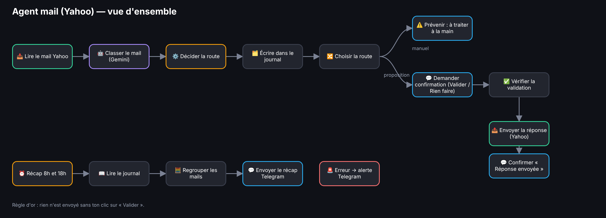
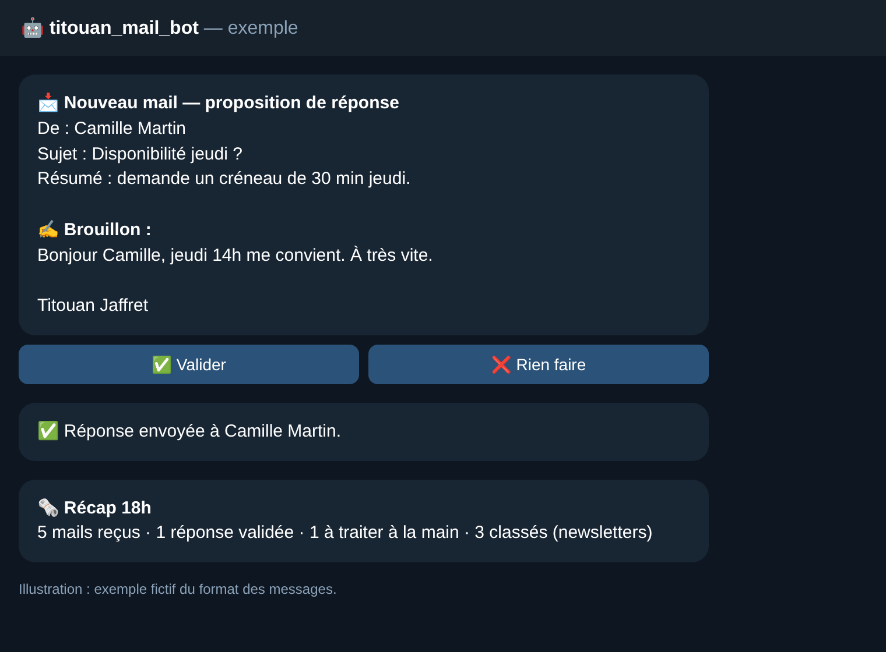

# 📬 Agent mail (Yahoo) — n8n + Gemini + Telegram

Un agent qui lit ma boîte Yahoo, comprend chaque mail, me prévient sur Telegram et **n'envoie une réponse qu'après mon clic sur « Valider »**.

## 🎥 Démo vidéo (5 min)
▶️ **[Voir la démo sur Loom](https://www.loom.com/share/177075692c9f4c5f9b0b0d8bb9c241a8)** · ou télécharger la vidéo du dépôt : [`3-video/demo.mp4`](3-video/demo.mp4) · transcript : [`4-transcript/transcript.md`](4-transcript/transcript.md)

## Ce qu'il fait
- 📥 **Lit** chaque nouveau mail (IMAP), sans rien déplacer ni supprimer.
- 🤖 **Classe** avec Gemini : catégorie, résumé, brouillon de réponse, niveau de confiance.
- 🔀 **Route** : sensible ou incertain → alerte « à traiter à la main » · newsletter / notification / spam → journal seulement · sinon → proposition de réponse.
- ✅ **Demande confirmation** sur Telegram (boutons Valider / Rien faire), puis envoie la réponse depuis Yahoo.
- ⏰ **Récap** à 8h et 18h, et 🚨 **alerte Telegram** si une étape plante.

*Illustration : exemple fictif du format des messages.*

## Contenu du dépôt
| Dossier | Contenu |
|---|---|
| `1-workflow/` | `agent-mail.workflow.ts` : le workflow n8n (SDK TypeScript) |
| `2-skills/` | `interview/`, `doubt-code/`, `n8n-workflows/` : les 3 skills Claude utilisés (`SKILL.md`) |
| `3-video/` | `demo.mp4` : la démo du workflow en vidéo (5 min) |
| `4-transcript/` | `transcript.md` : le texte de la vidéo |
| `images/` | les illustrations de ce README |

## Installation rapide
1. Remplacer `VOTRE_CHAT_ID` (ton Id Telegram) et `votre.adresse@yahoo.com`.
2. Reconnecter les credentials : IMAP et SMTP Yahoo (mot de passe d'application), Google Gemini, Telegram.
3. Créer la Data Table `mails_agent` (colonnes texte : date, sujet, expediteur, categorie, route, resume).
4. Publier le workflow.

## Limites
Pas d'archivage ni d'étiquette sur Yahoo · les rendez-vous détectés sont signalés, pas ajoutés à l'agenda.
